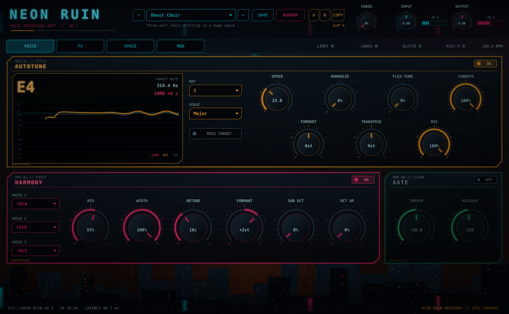

# Syntho — NEON RUIN experimental vocal processor (VST3 / AU / Standalone)



A vocal multi-effect built for experimenting: pitch correction, harmonies, MIDI-controlled
vocal chords, destruction, space, glitch and modulation — in a neon-noir ruined-city design.

## Pages

| Page | Modules |
|---|---|
| **VOICE** | Autotune (with live pitch graph), Harmony (3 voices + sub/octave layers), Gate |
| **FX** | EQ, Compressor, De-esser, Transmission (drive/crush/radio/ring mod), Doubler |
| **SPACE** | Delay (sync, ping-pong, reverse), Reverb (freeze), Chorus, Glitch |
| **MOD** | 2 LFOs (any target, tempo sync), Chaos macro, drag-and-drop signal chain |

Header: preset browser (15 factory presets + your own), **RANDOM**, **A/B** compare, **CHAOS** knob,
input/output. Hover any control for a short explanation.

Signal chain: `IN → GATE → AUTOTUNE + HARMONY → [EQ, DE-ESS, COMP, TRANSMIT, DOUBLER, CHORUS, DELAY, REVERB, GLITCH — any order] → OUT → safety limiter`

## Highlights

- **Autotune** — YIN detection + TD-PSOLA shifting (keeps the voice character). Speed, Humanize,
  Flex-Tune, Natural Vibrato, Formant, Transpose, Mix. Sibilants and breaths are never shifted.
- **MIDI target** — hold notes on a MIDI keyboard; the voice snaps to them (any octave).
- **Harmony** — up to 3 voices: scale-aware intervals (3rd, 4th, 5th, 6th, octave) or **MIDI**
  (each voice sings one of the notes you hold → play chords, the voice sings them). Plus sub-octave
  and octave-up layers, width, detune and formant for the extra voices.
- **Transmission** — saturation, bit-crusher/sample-rate reducer, radio/telephone band-limit, ring modulator.
- **Glitch** — tempo-synced beat repeat with random reverse.
- **LFOs** — Sine, Triangle, Saw, Square, S&H, Drift; 23 targets (incl. Transpose for stepped melodies, Volume for tremolo).
- **Chaos** — one knob pushes many parameters toward extremes and drives the LFOs harder.
- **Random** — a random but musical setting; **A/B** to compare; **SAVE** your own presets
  (stored in `Documents/Neon Ruin/Presets`).
- **Safety limiter** — always on at the output (-0.5 dBFS ceiling), so extreme settings can't blast
  your speakers. The LIMIT light shows when it is working.

## Factory presets
Init · Natural Pop · Hard-Tune Robot · Android Radio · Ghost Choir · Vocal Chords (MIDI) · Monster ·
Fairy · Ruins Transmission · Glitch Prophet · Frozen Cathedral · Reverse Dreams · Wide Double ·
Breathing Formant · Chaos Engine. Demos (synthetic test singer): `docs/audio/presets/`.

## Using MIDI
The plugin is an audio effect that also accepts MIDI. How to route MIDI to it depends on the DAW:
- **Ableton Live:** create a MIDI track, set *MIDI To* → the vocal track → "Neon Ruin".
- **Logic Pro:** use the AU version; select the vocal track's plugin as side-chain MIDI destination from a software-instrument track.
- **Reaper / Bitwig / Cubase:** send a MIDI track to the plugin's MIDI input.

## Latency
~49 ms, reported to the DAW (compensated automatically when mixing). For live monitoring while
recording, switch AUTOTUNE and HARMONY off or use your DAW's low-latency mode.

## Get a build
1. Push this folder to a GitHub repository.
2. GitHub Actions builds Windows and macOS versions automatically (tab **Actions** → latest run → **Artifacts**).
3. Copy `Neon Ruin.vst3` to `C:\Program Files\Common Files\VST3\` (Windows) or
   `~/Library/Audio/Plug-Ins/VST3/` (macOS), then rescan plugins.

macOS: unsigned plugins may be blocked — run `xattr -cr ~/Library/Audio/Plug-Ins/VST3/Neon\ Ruin.vst3`.

Local build (CMake + Visual Studio 2022 or Xcode):
```
git clone --depth 1 --branch 8.0.9 https://github.com/juce-framework/JUCE.git JUCE
cmake -B build -DCMAKE_BUILD_TYPE=Release
cmake --build build --config Release
```

## Tests
`cmake -B build-snap -DNEON_BUILD_SNAPSHOT=ON` builds two dev tools:
- `TuneTest` — synthetic singer, pitch-accuracy/null/robustness tests, harmony and MIDI tests (`tools/analyse.py` measures the results).
- `UISnapshot` — renders all UI pages, renders every factory preset, and stress-tests the randomiser (200 seeds).

## Code map
- `Source/DSP/PitchCorrector.h` — autotune + harmony engine
- `Source/DSP/Effects.h` — gate, de-esser, transmission, doubler, delay, glitch, LFO, safety limiter
- `Source/Params.h` — all parameters, modulation targets, Chaos mapping, randomiser ranges, factory presets
- `Source/PluginProcessor.*` — signal chain, modulation, presets, A/B
- `Source/PluginEditor.*` — the UI

## Licensing
Built on JUCE 8 (AGPLv3, or a commercial JUCE licence if you sell it closed-source).
